<!-- Github's Readme Section -->
<h3 align="center">
    <!-- Trophy cards -->
   
</h3>
 

<h3 align="center">Vue 3 & Nuxt 4 frontends (TS) ● Laravel & PHP backends ● Python ● Fullstack from Iran</h3>

    <em>Fullstack developer · 4 years of production work · Member of <a href="https://github.com/kowshan">Kowshan</a></em>

    
    

---

### ＃ About Me
▎∅ **Frontend Developer** ⌱ performant UIs with Vue 3 + Nuxt 4 (TypeScript) 
▎∅ **Backend Engineer** ⌱ Laravel and PHP services, API layers, Blade templates 
▎∅ **Python** ⌱ scripting, tooling, backend support 
▎∅ **Systems** ⌱ Linux workflows, SQL, Bash, advanced configs 
▎∅ **Security-minded** ⌱ secure, robust, scalable web platforms 
▎∅ **Production-first** ⌱ real platforms, not demos — national-scale systems in the wild 
Currently: fullstack with a Vue/Nuxt focus, remote-first from Ardabil, Iran. Open to small freelance work.

 

### ＃ ACTIVITY

  
  

 

### ＃ Tech Stack

<table width="100%">
  <tr>
    <td><b>▎VUE 3 …</b> component-driven interfaces, Composition API</td>
  </tr>
  <tr>
    <td><b>▎NUXT 4 …</b> SSR frontends in TypeScript, file-based routing, Nitro</td>
  </tr>
  <tr>
    <td><b>▎LARAVEL …</b> backend services, API layers, auth, Blade</td>
  </tr>
  <tr>
    <td><b>▎PHP …</b> the backend backbone</td>
  </tr>
  <tr>
    <td><b>▎PYTHON …</b> automation, scripting, tooling</td>
  </tr>
  <tr>
    <td><b>▎TYPESCRIPT / JS …</b> typed frontends, shared logic</td>
  </tr>
  <tr>
    <td><b>▎LINUX …</b> server-side workflows, deployment, Bash</td>
  </tr>
  <tr>
    <td><b>▎SQL …</b> schema design, queries, data modeling</td>
  </tr>
</table>

 

### ＃ STREAK

  

 

### ＃ Selected Open-Source

▎<a href="https://kowshan-ui-kit.pages.dev/"><b>１ Kowshan UI Kit ⎋﹕</b></a> component collection used across my projects 

 

### ＃ Production Work

Not demos, production systems. I've shipped national-scale platforms, internal tools, and fullstack products: a multi-language therapy platform for psychology, psychiatry and counselling; three separate Vue applications for the National Iranian Gas Company (CRM, field PWA, and a reward-based engagement app), each with its own visual identity; a reservation-first cafe system built around consultants and brokers; a business diagnostics platform backed by the Ministry of Industry, Mine and Trade; a professional qualification platform that maps career gaps and tells users exactly what to learn next; and a project & task management platform for organizations. Some public, some behind closed doors. All of them built to run.

<table width="100%">
  <tr>
    <td><b>▎ASAYROOM</b></td>
    <td>Vue 3 + Nuxt 4</td>
    <td>National therapy platform — multilingual, video verification, assessments, in-app payments</td>
  </tr>
  <tr>
    <td><b>▎NIGC</b></td>
    <td>Vue 3</td>
    <td>Three internal apps — CRM, Field PWA, Gaziom — multi-theme, unique design each</td>
  </tr>
  <tr>
    <td><b>▎CAFE MAHOUR</b></td>
    <td>Nuxt 3</td>
    <td>Reservation-first cafe system — table packages, two-level admin, full restaurant flow</td>
  </tr>
  <tr>
    <td><b>▎BAAM</b></td>
    <td>Nuxt 4</td>
    <td>Professional qualification platform — resume builder, gap analysis, learning suggestions</td>
  </tr>
  <tr>
    <td><b>▎KARAN</b></td>
    <td>Vue 3 + Blade</td>
    <td>Project & task management — full lifecycle from planning to final evaluation</td>
  </tr>
  <tr>
    <td><b>▎SCAN BUSINESS</b></td>
    <td>Nuxt 4</td>
    <td>Business diagnostics against EFQM, BPMM, APQC & Palladium maturity models</td>
  </tr>
</table>

**☍** [**v-codesmith.github.io**](https://v-codesmith.github.io/): full write-ups

 

### ＃ Contact
Best way to reach me. Email and Telegram. 
〓 **Portfolio ━** [**v-codesmith.github.io**](https://v-codesmith.github.io/) 
〓 **GitHub ━** [**github.com/V-CodeSmith**](https://github.com/V-CodeSmith) 
〓 **Email ━** [**mohammad.ajdari.2002@gmail.com**](mailto:mohammad.ajdari.2002@gmail.com) 
〓 **Telegram ━** [**@mamadx008**](https://t.me/mamadx008) 
〓 **Instagram ━** [**@mohammad_azhdari81**](https://instagram.com/mohammad_azhdari81) 
〓 **Kowshan UI Kit ━** [**kowshan-ui-kit.pages.dev**](https://kowshan-ui-kit.pages.dev/) 

 

محمد اژدری — Mohammad Azhdari · Fullstack Vue & Nuxt developer · Ardabil, Iran
